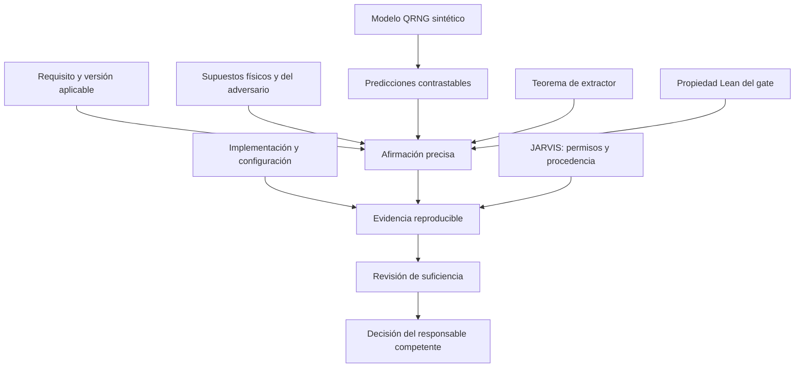

# Caso de aseguramiento que conecta las seis misiones

## Afirmación limitada

«Para una configuración declarada del generador y su entorno, el expediente permite reproducir pruebas seleccionadas y examinar los supuestos de las garantías reclamadas». No se reclama certificación ni una cantidad de entropía acreditada para un dispositivo real.

## Obligaciones y fallos posibles

| Enlace | Qué se debe justificar | Contraejemplo que lo rompe |
|---|---|---|
| Fuente física → modelo | ruido acreditable, parámetros, correlación, condiciones de operación y conocimiento adversario | sumar ruido gaussiano conocido por el adversario y contarlo como entropía secreta |
| Modelo → entropía | distribución condicional pertinente; error del modelo; horizonte y confianza | estimar sólo el sesgo marginal y asumir bits independientes |
| Entropía → extractor | independencia de semilla; entropía lateral; presupuesto de error y composición | repetir un bloque con la misma semilla y contar dos veces su entropía |
| Propiedad Lean → dispositivo | correspondencia de transiciones, representación finita y orden de ejecución | probar Nat y desplegar un contador que desborda; liberar el bit antes de comprobar fallo |
| Ejecución → evidencia | bytes de entrada, herramienta, configuración, salida y resultado ligados | conservar un hash de un fichero diferente al usado en la prueba |
| Evidencia → requisito | alcance, criterio de aceptación y revisor | marcar PASS porque existe un PDF, aunque su contenido no soporte la afirmación |
| Agente → acción | capacidades, autoridad, destino y aprobación vinculados a la acción concreta | una aprobación genérica reutilizada para un plan modificado |

## Reglas de revisión

- Un PASS de software expresa sólo el criterio del adaptador ejecutado. No debe ascender a «conforme» sin la decisión correspondiente.
- Un fallo de herramienta produce ERROR o BLOCKED, no éxito por ausencia de resultados.
- La ausencia de evidencia produce MISSING o NEEDS_REVIEW. «No aplicable» requiere motivo y decisión explícitos.
- Los resultados matemáticos declaran todos sus supuestos; las simulaciones registran seed y parámetros; las inferencias de mercado se presentan como hipótesis.
- Un hash sin ancla confiable detecta algunas modificaciones accidentales, pero un atacante capaz de reescribir archivo y manifiesto puede recomputarlo.
- La aprobación humana tiene que ocurrir fuera del dominio de autoridad del agente que propone la acción. Una API con `actor='human'` no demuestra presencia humana.

## Expediente mínimo propuesto

1. Ficha de alcance: producto/configuración/clase/entorno y pregunta exacta.
2. Baseline de requisitos con identificadores estables, versiones e interpretación revisada.
3. Registro de supuestos y amenazas con responsable y mecanismo de refutación.
4. Código y datos reproducibles, resultados negativos incluidos.
5. Mapa afirmación → evidencia → requisito, sin equiparar cobertura a suficiencia.
6. Revisión independiente y registro de discrepancias.
7. Manifiesto del paquete final y procedimientos de reproducción.

Este esquema es diseño propio para la investigación y no reproduce una plantilla oficial de ningún organismo.
