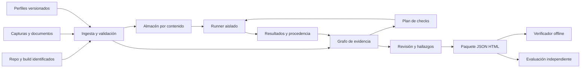

# Arquitectura de producto y confianza

Este documento describe una arquitectura objetivo. El prototipo de la misión 2 implementa un subconjunto local; no asumir que incluye servicios, firmas, aislamiento de ejecución o integraciones de producción aquí propuestas.

## Principio: una conclusión necesita contexto

Un PDF, un hash y un resultado PASS no bastan. La unidad de trabajo debe ser una afirmación situada: requisito de una edición concreta, producto/configuración definida, hipótesis, evidencia, procedimiento, resultado y revisión. Dos informes que contienen el mismo nombre de test pueden representar configuraciones o garantías distintas.

La plataforma tendrá tres planos: contenido inmutable y portable; ejecución controlada; revisión humana. Los modelos de lenguaje pueden proponer clasificación, texto o enlaces, pero no convertir una evidencia ausente en presente ni elevar automáticamente una conclusión a aceptada.

## Entidades mínimas

| Entidad | Campos esenciales | Invariante |
|---|---|---|
| StandardBaseline | familia, edición, interpretación, URL, hash de fuente si autorizado, fecha de acceso | Una edición no cambia silenciosamente |
| Requirement | ID local, localizador normativo, texto propio, aplicabilidad, criterio | Un ID no basta para identificar una revisión |
| ProductSnapshot | producto, versión, source revision, build digest, entorno, configuración | El resultado se atribuye a un snapshot exacto |
| Assumption | enunciado, ámbito, justificación, responsable, condiciones de invalidación | Una hipótesis no se convierte en hecho por repetición |
| Dataset | digest, formato, adquisición, límites, canales, reinicios, procesamiento | Conservar relación con origen y transformación |
| Procedure | versión, entradas, pasos, parámetros, herramienta, entorno | Un cambio semántico produce nueva versión |
| Execution | procedure digest, input digests, fechas, entorno, logs, status | Una ejecución fallida no desaparece de la historia |
| Evidence | tipo, contenido, origen, dependencias, limitaciones | Integridad y suficiencia son estados distintos |
| Claim | sujeto, alcance, requisitos, evidencias, hipótesis, grado de apoyo | Ningún claim puede omitir supuestos necesarios |
| Review | autor/rol, snapshot revisado, decisión, rationale | La aprobación apunta al contenido aprobado |
| Finding | severidad, objeto, condición, reproducción, resolución | Cerrar no elimina el hallazgo original |

IDs legibles ayudan a revisar; digests identifican contenido. Para JSON se necesita una canonicalización definida, incluyendo números, Unicode y orden de claves. Versionar el formato y anteponer un dominio al material hasheado, por ejemplo `cryptosure:evidence:v1`, evita confundir tipos. Un hash sólo prueba igualdad con una referencia; no prueba autoría, fecha, veracidad o completitud.

## Estados ortogonales

No usar un único booleano `compliant`.

| Eje | Valores ilustrativos |
|---|---|
| Integridad | desconocida, coincide_con_manifest, no_coincide |
| Procedencia | declarada, observada_por_runner, firmada_por_identidad_confiada |
| Ejecución | no_ejecutada, pass, fail, error, bloqueada |
| Aplicabilidad | pendiente, aplicable, no_aplicable_justificado |
| Suficiencia | sin_revisar, insuficiente, aceptada_por_revisor |
| Vigencia | vigente_para_snapshot, potencialmente_obsoleta, obsoleta |
| Decisión externa | ninguna, registrada_con_referencia_oficial |

`pass` significa que un procedimiento con versión y entradas concretas produjo el resultado esperado. `aceptada_por_revisor` significa que esa persona aceptó esa evidencia para ese alcance. Ninguno crea un certificado. El informe presenta los ejes separados, con el alcance al lado, para evitar conclusiones falsas por diseño de interfaz.

## Evaluación de impacto y cambios

El grafo representa dependencias dirigidas: una afirmación depende de requisitos, snapshots, hipótesis y evidencias; las evidencias dependen de procedimientos, entradas y entorno. Cambiar un nodo marca conservadoramente su clausura de dependientes como necesitada de revisión. Esta operación es mecánica, pero la definición correcta de dependencias requiere juicio.

Ejemplo: se modifica el coeficiente de un control de umbral. Puede conservarse un test vector de un algoritmo no afectado, pero deben revisarse modelo temporal, campaña de adquisición, hipótesis de independencia y estimaciones de entropía. Cambiar sólo la versión de una plantilla de portada puede no requerir repetir un ensayo. La plataforma puede presentar una propuesta de equivalencia, nunca concederla por comparar nombres de archivo.

Una aprobación se identifica por un conjunto de digests. Si varía cualquiera de ellos, la aprobación histórica sigue existiendo pero deja de cubrir automáticamente el snapshot actual. No editar en sitio una evidencia aprobada. Las relaciones de equivalencia entre configuraciones tienen autor, justificación y límites.

## CI/CD

El pipeline recomendado para un pull request es: construir snapshot → resolver perfil fijado → ejecutar checks deterministas → calcular diferencias de evidencia → producir paquete → bloquear sólo por política explícita. Los checks pueden detectar ausencia de archivos, versiones incompatibles, artefactos cambiados o fallos reproducibles. El criterio «este cambio no afecta a la seguridad» no se genera sólo con un diff textual.

Al hacer una release, fijar commit, estado del árbol, dependencias, configuración de compilador, digest del binario y entorno. Un commit Git no garantiza que el binario provenga de ese código ni que el árbol estuviera limpio. Guardar procedencia de build o marcarla como declarada. El validador debe informar cuando falta esa conexión.

Los pipelines de revisión de contribuciones no confiables no reciben secretos ni permisos de escritura. La ejecución que necesite hardware usa una cola dedicada y una autorización explícita sobre la configuración del banco. En el MVP no se automatizan accesos a servidores de validación ni submissions.

## Extensión por perfiles

Un perfil tiene tres capas: referencias normativas; reglas de aplicabilidad; adaptadores de evidencia. Evitar textos normativos completos redistribuidos sin permiso. Usar identificadores/localizadores y explicaciones originales, con importación local del documento licenciado si procede.

Los perfiles 90B, FIPS, CC y MEGA pueden compartir un objeto `Dataset` o `ProductSnapshot`; sus reglas de aceptación permanecen separadas. Una correspondencia entre requisitos tiene relación explícita: mismo artefacto útil, apoyo parcial, implicación condicionada o equivalencia demostrada. La equivalencia no es el valor por defecto.

Un adaptador NIST debe importar resultados de herramientas/protocolos mantenidos y conservar los originales. Toda transformación produce otro objeto con trazabilidad. Integrar con la interfaz pública existente es preferible a emular conclusiones del servidor. Un JSON que se parezca al protocolo no debe etiquetarse como aceptado por NIST.

## Selección tecnológica para tres ingenieros

Primera versión: Python para CLI/validación y adaptadores, JSON Schema para contratos, SQLite para índice local, filesystem por contenido para artefactos y HTML estático para revisión. Git versiona perfiles, reglas y código; los datos grandes se referencian por digest en un almacén de objetos o almacenamiento local, sin introducirlos indiscriminadamente en el historial.

Cuando la colaboración lo justifique: API pequeña, PostgreSQL, cola de trabajos y almacén compatible con S3 con retención configurable. Evitar una base de grafos dedicada al principio: relaciones tipadas y consultas recursivas bastan para el MVP. No crear microservicios antes de medir aislamiento o escalado necesario.

SaaS, on-prem y paquete offline deben compartir formato e invariantes; una instalación privada no puede depender de una verificación remota oculta. La recuperación ante desastre se prueba restaurando paquetes y decisiones desde backups, no sólo exportando la base de datos.

## Seguridad y modelo adversario

| Amenaza | Control propuesto | Límite residual |
|---|---|---|
| Documento induce al agente a ejecutar instrucciones | Ingesta como datos; no autoridad derivada del contenido | Un revisor puede interpretar mal contenido persuasivo |
| Perfil solicita ejecutar comandos arbitrarios | Checks de allowlist; parámetros validados; perfiles revisados | Plugin autorizado puede tener vulnerabilidades |
| Artefacto sustituido después de revisión | CAS, snapshot inmutable, digest en revisión | Si manifest y artefacto se sustituyen juntos sin ancla confiable, hash no basta |
| Ejecución fabrica resultados | Identidad del runner, logs, reproducción independiente; firmas en fase posterior | Firma de un runner comprometido no demuestra verdad |
| Ruta escapa del workspace | Resolver rutas, prohibir traversal y controlar enlaces simbólicos | TOCTOU requiere medidas a nivel de descriptor/sandbox |
| Dos clientes mezclan evidencia | Aislamiento, autorización por objeto y tests de tenancy | Backups y export también deben aislarse |
| Falso PASS tras error de parser | Fallo cerrado, error distinto de fail, campos obligatorios | Validación sintáctica no prueba semántica correcta |
| Borrado de hechos negativos | Append-only lógico y retención acordada | Administrador del almacenamiento requiere controles adicionales |

El SaaS necesita autenticación fuerte, RBAC, cifrado en tránsito/reposo, gestión de claves, auditoría de acceso y límites de retención. Estos controles son trabajo de producto, no características demostradas por un prototipo local. Las firmas deben usar bibliotecas existentes y un modelo explícito de identidad, revocación y raíz de confianza; no criptografía propia.

## Papel acotado de IA

Aplicaciones útiles: proponer enlaces entre requisitos y evidencias, detectar contradicciones, redactar resúmenes con referencias exactas y priorizar documentos faltantes. Cada salida propuesta conserva los IDs de entradas y versión del modelo, queda como borrador y puede ser rechazada. La búsqueda recupera contexto, no autoridad.

Una evaluación de calidad de IA utiliza ejemplos negativos: requisito inexistente, evidencia de otra versión, documento que dice lo contrario, hipótesis no satisfecha y ataque de prompt injection. Métrica principal: falsos apoyos afirmativos en conjunto adversario, no sólo similitud semántica. Empezar sin LLM en el camino determinista facilita vender reproducibilidad.

## Interfaces entre esta misión y el prototipo

El agente de prototipo está implementando JSON versionado, evidencias por contenido, checks permitidos, informes y Git en lectura. Sus estados PASS/FAIL/REVIEW/BLOCKED pertenecen al motor técnico. La arquitectura propone futuras separaciones más finas, pero no exige reescribir el prototipo dentro de la ventana actual.

Próximo contrato de integración: importar su manifest y resultado, añadir un objeto de revisión ligado a digests y demostrar que una modificación de requisito o evidencia hace aparecer «requiere revisión». La primera venta debe apoyarse en ese caso de cambio concreto.
