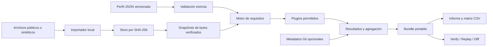

# Arquitectura y contratos

## Diseño ejecutable



El límite de confianza está entre datos y código. Un perfil es datos declarativos.
Puede seleccionar nombres del registro de plugins; no aporta código, rutas de módulos,
comandos, URLs que se descarguen ni argumentos de shell. Incorporar un plugin nuevo
requiere modificar y revisar el código de la herramienta. Esto reduce la superficie
de ejecución a costa de no admitir plugins arbitrarios en tiempo de ejecución.

## Contrato del perfil

`schema_version` versiona el formato; `id` identifica el perfil; `version` identifica
la edición editorial. `standard` conserva familia, edición y URL de referencia.
`limitations` es obligatorio para hacer explícito el alcance. Estos metadatos no
acreditan que el perfil esté autorizado por quien publicó el estándar.

Cada requisito contiene id globalmente único, título, cláusula de referencia,
`human_review`, referencias a evidencias y checks. Los checks tienen id globalmente
único, tipo de plugin, id de artefacto y parámetros. El requisito depende de la unión
de sus referencias explícitas y de las entradas de sus checks. Si falta cualquiera,
su resultado queda BLOCKED salvo que ya exista un FAIL que deba preservarse.

Un requisito documental sin checks sólo es válido con `human_review:true`. Así,
presencia de un archivo no se convierte automáticamente en aprobación de su contenido.
La configuración manual de `human_review:false` sigue siendo una decisión del autor
del perfil y no una propiedad derivada del estándar.

## Evidencias

El store contiene `index.json` y `blobs/<sha256>`. Cada identificador lógico liga bytes
con un digest, tamaño, tipo MIME, nombre base del origen y fecha de importación. Una
segunda importación con el mismo id y bytes distintos se rechaza; debe elegirse otro
id o una nueva baseline. No se conserva la ruta absoluta del documento de origen.

Al ejecutar, el motor lee cada artefacto requerido, compara hash y tamaño, y conserva
el snapshot en memoria. Los checks y la exportación consumen **el mismo snapshot**:
modificar el archivo de origen después de importar no cambia los bytes ensayados.
Las escrituras del store son atómicas por archivo; no constituyen una transacción
multiusuario. Se presupone un escritor único y un filesystem local de confianza.

Cada resultado incluye `claim_kind:experiment`. Una evidencia importada que declare
una prueba formal no se convierte por ello en una prueba ejecutada por CryptoSure.
La adecuación, origen y relación entre teorema y producto requieren revisión adicional.

## Bundle

```text
bundle/
  profile.json             perfil normalizado exacto
  run.json                 resultados, referencias y procedencia
  report.md                vista para revisión
  traceability.csv         relaciones requisito-check-artefacto
  artifacts/<sha256>       bytes exactos usados
  seal.json                inventario de hashes y tamaños
  root.sha256              digest del sello, sin autenticación intrínseca
```

La serialización JSON ordena claves, usa UTF-8 y rechaza valores no finitos y claves
duplicadas. Es una normalización de esta implementación Python, **no una declaración
de conformidad con RFC 8785/JCS**, ni una garantía de equivalencia numérica entre
lenguajes. Un futuro formato interoperable debe fijar ese contrato por separado.

El source digest liga todos los `.py` del paquete, por nombre ordenado y contenido.
No cubre el binario Python, OpenSSL, sistema operativo ni toolchain; la misma versión
de fuente puede comportarse distinto en otro entorno. Una release de producción
necesita manifest de dependencias, imágenes identificadas y attestations verificables.

## Determinismo y límites

Los algoritmos operan determinísticamente sobre sus entradas. El bundle completo
incluye timestamps y por ello no pretende producir el mismo root digest en ejecuciones
distintas. `diff` separa cambios de entradas de cambios del instante de ejecución.

Se limita JSON a 2 MiB, cada artefacto a 16 MiB, snapshots acumulados a 64 MiB, entradas
acumuladas de checks a 128 MiB, perfiles a 1000 requisitos y 4096 checks. Superar un
límite de evidencia/check produce BLOCKED. Son límites de demostrador; no sustituyen
cuotas de CPU/memoria del sistema operativo ni aislamiento de procesos de producción.
La lectura verificadora limita cada bundle a 96 MiB sellados y conserva sus bytes
para replay/diff; comparar dos bundles puede retener hasta dos snapshots de ese tamaño.

## Semántica de los plugins

- `sha256_vectors`: compara `hashlib.sha256` con mensajes y hashes proporcionados.
  Una coincidencia no valida una implementación de hardware, una biblioteca ajena,
  un modo aprobado ni una campaña ACVP.
- `repetition_count`: datos binarios sin empaquetar, alarma con racha `>= cutoff`.
  No deriva el cutoff de una cota de entropía ni demuestra cobertura de fallos.
- `adaptive_proportion`: ventanas completas no solapadas, símbolo inicial como
  referencia, contador que incluye ese símbolo, alarma `>= cutoff`. Rechaza colas
  parciales; los parámetros de demo no son parámetros normativos de una validación.
- `json_field_equals`: recorre claves de objeto y compara JSON con sensibilidad de
  tipos; `true` y `1` difieren. Comprueba una declaración, no la verdad de esa declaración.

Los tests exhaustivos recorren todos los strings binarios de longitud 1–9 para RCT
y todas las ventanas binarias de longitud 2–8 para APT, comparándolos con modelos
de referencia sencillos. Esto detecta errores de contadores/fronteras dentro de esos
dominios; no es una prueba formal de todos los tamaños posibles.
