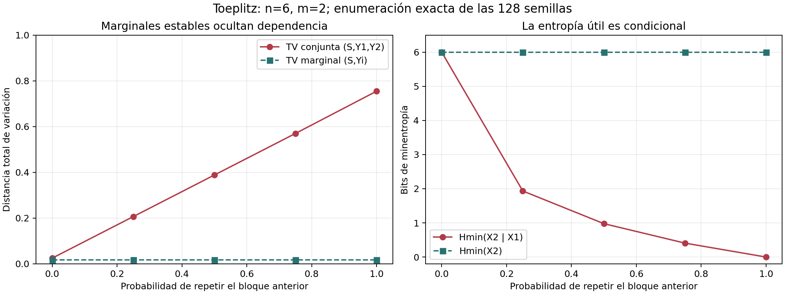

# Resultados reproducibles

Los datos exactos se guardan como fracción racional y decimal en [results.json](results.json). La curva usa `X₂=X₁` con probabilidad `ρ`, y un bloque nuevo independiente con probabilidad `1−ρ`. Cada marginal de entrada sigue siendo uniforme; la entropía condicional y la distribución conjunta de salida cambian sustancialmente.

La visualización se genera con `python3 plot_results.py` y puede exportarse como [SVG](correlation_vs_entropy.svg). El experimento Monte Carlo de 20 000 pares está separado de la enumeración exacta y usa parámetros sintéticos `n=24, m=8`; no se interpreta como prueba de una fuente física.
