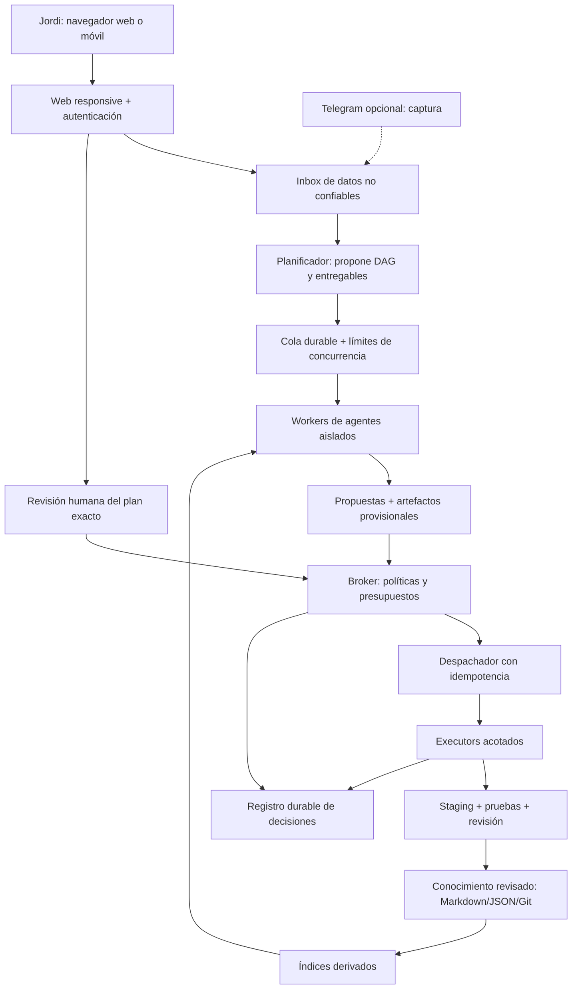

# Arquitectura propuesta de JARVIS

**Decisión principal:** construir una infraestructura de trabajo con agentes intercambiables, no una conversación perpetua con acceso ilimitado. La unidad persistente es el proyecto y sus artefactos; la unidad de autorización es una acción concreta; la unidad de recuperación es una ejecución con historial durable.

Todo lo siguiente es propuesta de ingeniería salvo las capacidades documentadas y citadas explícitamente.

## 1. Objetivos y límites

Jordi necesita producir investigación criptográfica, código, decisiones empresariales y conocimiento reutilizable. Un sistema útil debe convertir una entrada ambigua en un plan revisable, dividir trabajo independiente, producir evidencia, integrar resultados y conservar lo aprendido con procedencia. No debe confundir una respuesta convincente con una conclusión demostrada.

El entorno operativo es un VPS o servidor cloud. «Local» significa local a ese servidor en el MVP. No se instalará agente, túnel, sincronizador ni cliente de control remoto en el PC personal. Un modo local futuro sería una distribución independiente elegida expresamente; no una dependencia oculta de la arquitectura actual.

Quside queda fuera de los espacios de datos y conectores. El dominio personal comprende investigación pública, proyectos personales y datos que Jordi introduzca expresamente. El diseño de finanzas se limita a análisis y preparación: ninguna capacidad para operar, comprar, contratar o transferir. Las comunicaciones y publicaciones son conectores opcionales futuros sujetos a autorización separada; el prototipo carece de ellos.

## 2. Componentes y fronteras



El plano de control contiene identidad, políticas, cola, aprobaciones, presupuestos y auditoría. El plano de trabajo contiene procesos de agentes, repositorios temporales y herramientas limitadas. Una salida del plano de trabajo jamás modifica directamente políticas o credenciales.

El broker es pequeño y determinista. Acepta objetos tipados; no interpreta texto libre como órdenes. El LLM no decide que una operación es inocua: la clasificación deriva del tipo de herramienta, argumentos, destino y contexto comprobado. Cada executor corresponde a una capacidad concreta, por ejemplo leer un artefacto, crear un parche dentro de un checkout o ejecutar una lista de pruebas en un sandbox.

## 3. Un flujo completo

1. Jordi captura: «Estudiar reutilización de semillas Toeplitz con bloques correlacionados». El inbox conserva texto original, canal, tiempo, digest y estado `untrusted`.
2. El planificador propone pregunta, supuestos, fuentes admisibles, entregables y condiciones de terminación. La decisión de investigación se distingue de cualquier acción externa.
3. Se crean tres tareas: teoría, literatura y experimentos. Cada una tiene directorio/branch propio, presupuesto, deadline y aceptación verificable. Una cuarta tarea de revisión depende de las anteriores.
4. El broker concede permisos de investigación pública y escritura en staging dentro del proyecto. Las capacidades ya autorizadas no requieren confirmaciones repetidas.
5. Los agentes devuelven notas, código, citas y un manifiesto de ejecución. El supervisor sólo recibe resultados y bloqueos, no transcripciones indiscriminadas.
6. Un verificador comprueba enlaces, hashes, tests y contradicciones. Una conclusión puede pasar de `hypothesis` a `experiment`; sólo una demostración adecuada permite `proof` y se conserva qué máquina o kernel la verificó.
7. Se genera un parche de conocimiento. La promoción al repositorio revisado sigue la política de ese proyecto; una acción protegida muestra diff exacto y dependencias.
8. Se archiva evidencia y se actualiza el estado del proyecto. Si una fuente cambia, se marcan las conclusiones dependientes como potencialmente obsoletas; no se reescribe su historia.

## 4. Modelo de memoria

No hay una única «memoria». Se separan cinco dominios:

| Dominio | Autoridad y formato | Uso |
|---|---|---|
| Estado operativo | Eventos y tablas transaccionales | Tareas, leases, aprobaciones, reservas, intentos |
| Conocimiento revisado | Markdown + JSON versionados | Afirmaciones, decisiones, modelos, proyectos |
| Evidencia inmutable | Objetos por digest | PDFs públicos permitidos, logs, datasets sintéticos, binarios |
| Índices derivados | FTS/embeddings regenerables | Recuperación, nunca fuente de verdad |
| Memoria temporal | Contexto/checkpoints de run | Continuidad de una tarea; caduca y se minimiza |

Una afirmación registra `claim_id`, texto acotado, `claim_kind`, fuentes, supuestos, alcance, contradicciones, fecha de observación, período de validez y revisiones. «NIST exige X» requiere documento/versión/cláusula. «El mercado pagará Y» es hipótesis hasta que exista evidencia comercial. No almacenar razonamiento privado detallado de modelos: conservar decisiones, explicaciones breves, supuestos y evidencias suficientes para auditarlas.

La recuperación aplica ACL **antes** de formar contexto o embeddings compartidos. Un índice de un proyecto no mezcla datos de otro por comodidad. El resultado de búsqueda se etiqueta como contenido, no instrucción. Documentos que digan «ignora tus reglas» pueden citarse y analizarse, pero no tienen capacidad de cambiar herramientas ni políticas.

Estructura portable propuesta:

```text
jarvis-vault/
  manifest.json
  people/jordi/preferences.json
  inbox/YYYY/MM/<id>.json
  projects/<slug>/PROJECT.md
  projects/<slug>/tasks/<id>.json
  knowledge/claims/<id>.json
  knowledge/notes/<id>.md
  decisions/<id>.md
  evidence/sha256/<digest>/manifest.json
  evidence/sha256/<digest>/payload
  exports/events-YYYY-MM-DD.jsonl
  policies/<revision>.json
```

SQLite/PostgreSQL no es la única copia legible: export diario determinista a JSONL, esquema versionado y manifest con hashes. La importación valida IDs, referencias, límites de tamaño y versiones. Un export no contiene secretos de conectores. Git conserva historia de documentos revisados, no grandes blobs de entrenamiento ni claves.

## 5. Orquestación y planificación

El supervisor transforma objetivos en un DAG de tareas con dependencias explícitas. Cada tarea define entradas por digest, salida esperada, criterio de aceptación, propietario de escritura, presupuesto y una política de fallos. Un agente no crea una cadena ilimitada de subagentes: solicita subtareas al supervisor, que cobra la reserva al mismo proyecto y comprueba profundidad y fan-out.

Estados operativos recomendados:

```text
captured -> triaged -> planned -> ready -> running -> verifying -> done
                                  |         |            |
                                  v         v            v
                              blocked   indeterminate   rework
```

`indeterminate` significa que pudo ocurrir un efecto y falta recibo. No se reintenta ciegamente. Se consulta la idempotency key del destino o se reconcilia manualmente. Un lease evita workers concurrentes; un fencing token creciente impide que un worker con lease antiguo vuelva a escribir. Los heartbeats son señales de vida, no prueba de progreso.

La cola utiliza prioridades por valor esperado, urgencia, duración y desbloqueo de dependencias. Reservar un slot de coordinación/revisión cuando haya varios workers. La ocupación máxima es una táctica para trabajos independientes; no una métrica de éxito. Las tareas agotadas deben cerrarse, y la revisión debe tener presupuesto reservado.

Los límites son independientes: tokens, coste monetario, tiempo de pared, CPU, memoria, tamaño de salida, llamadas a herramientas y concurrencia. El scheduler reserva antes de despachar. Un gateway mide consumo real y aplica techo por llamada; el ledger reconcilia coste al completar. Si no se puede consultar el presupuesto semanal del proveedor, se informa «desconocido» y se usa un límite local explícito; no se inventa un porcentaje.

## 6. Tecnología mínima y evolución

| Capa | MVP recomendado | Criterio para cambiar |
|---|---|---|
| Estado | SQLite en disco local del VPS | Varios brokers/hosts o escrituras sostenidas justifican PostgreSQL |
| Cola | Tabla transaccional + worker y leases | Workflows largos complejos o operación multihost justifican Temporal |
| Agentes | Adaptador de Codex y contrato de salida | Añadir modelos si mejoran pruebas medibles, no por cantidad |
| Conocimiento | Markdown/JSON + Git + búsqueda textual | Embeddings cuando una evaluación muestre recall insuficiente |
| Interfaz | Web responsive instalable | App nativa sólo si una limitación real de UX lo exige |
| Objetos | Directorio por digest + backup cifrado | S3 compatible al crecer volumen/distribución |

SQLite permite concurrencia útil, pero WAL requiere procesos en el mismo host y no debe ponerse sobre un filesystem de red. El prototipo usa el journal estándar; un deployment puede evaluar WAL tras pruebas y versión fijada. [SQLite: WAL](https://www.sqlite.org/wal.html).

Temporal conserva historial y reanuda workflows mediante replay sujeto a restricciones de determinismo. Es apropiado cuando el coste operativo extra compra recuperación y coordinación que se necesita de verdad. Las llamadas a modelos y efectos deben ir en actividades; eso no hace idempotente un destino externo. [Temporal Workflow Execution](https://docs.temporal.io/workflow-execution).

LangGraph diferencia checkpoints de hilo y stores de memoria entre hilos. Sus interrupciones permiten esperar revisión, pero un nodo puede reejecutarse al continuar y repetir efectos. Usarlo como lógica dentro de una actividad o como único orquestador inicial; evitar dos motores de persistencia superpuestos sin una frontera precisa. [Persistence](https://docs.langchain.com/oss/python/langgraph/persistence), [Interrupts](https://docs.langchain.com/oss/python/langgraph/interrupts).

**ADR-01:** comenzar sin Temporal ni LangGraph; obtener primero un flujo fiable de investigación→artefacto→revisión. **ADR-02:** la persistencia propia usa contratos neutrales para permitir migración. **ADR-03:** no adoptar una base vectorial como sistema de registro. **ADR-04:** identidad y efectos permanecen fuera del proceso del agente. **ADR-05:** el MVP no tiene canal de acceso al PC local.

## 7. Integración con Codex y Git

Se inspeccionó el ejecutable local mediante `--version`, `--help`, `exec --help` y `app-server --help`; no se consultó configuración ni autenticación. La versión observada fue `0.167.0-alpha.4`, por lo que hay que fijar versión, generar schema del protocolo y hacer contract tests antes de actualizar.

Para un primer worker usar `codex exec` no interactivo con directorio de tarea y salida JSON; el wrapper valida el resultado y recoge artefactos. La ayuda local confirma `--json`, `--output-schema`, `--ephemeral` y opciones de sandbox. No activar opciones de bypass. La autenticación futura se aprovisiona fuera del worker con permisos mínimos y revisión explícita.

Para UI rica, App Server ofrece mensajes JSON-RPC y solicitudes de aprobación. Su documentación identifica stdio como transporte por defecto y marca WebSocket como experimental. Recomendación propia: usar stdio o socket interno y exponer únicamente la API autenticada de JARVIS, sin publicar el listener de Codex. Las aprobaciones del protocolo y las del broker se correlacionan por run/thread/turn/item. [App Server](https://learn.chatgpt.com/docs/app-server).

Los controles de red de comandos no cubren automáticamente búsquedas alojadas, apps, MCP ni navegador. La política debe revisar cada superficie por separado; «network off» en el sandbox de shell no significa «sin canales de salida» en todo el producto. [Agent approvals & security](https://learn.chatgpt.com/docs/agent-approvals-security).

Cada tarea de código obtiene worktree/branch independiente con base commit fijado. Sólo escribe su checkout y directorio de salida. Un integrador aplica parches, corre pruebas y resuelve conflictos en staging; no comparte un working tree mutable entre agentes. El commit, diff, estado dirty, toolchain y comandos de prueba quedan en la evidencia. Los hooks del repositorio son código no confiable: deshabilitados o ejecutados en el mismo sandbox. No ejecutar un checkout como parte del mero proceso de lectura.

## 8. Web, móvil y Telegram

La web presenta cuatro vistas: inbox, proyectos, runs y revisión. La revisión muestra acción, destino, contenido/diff, fuentes, coste máximo y expiración; el botón confirma el digest que el usuario ha visto. La UI móvil puede reducir detalle visual, pero no ocultar destinos o alcance. Lectura y borradores requieren menos fricción que efectos externos.

Telegram es opcional y empieza como captura. Cada mensaje se deduplica por bot/canal/update ID y se convierte en `untrusted`. No convierte automáticamente «sí» en aprobación privilegiada: una respuesta se vincula a una propuesta exacta y para alto impacto remite a la web con sesión autenticada. No enviar documentos sensibles al bot. La API documenta reintentos de webhooks y un `secret_token` en cabecera; esto autentica el webhook configurado, no la intención humana ni la seguridad del terminal. [Telegram Bot API](https://core.telegram.org/bots/api#setwebhook).

## 9. Recuperación y operabilidad

Objetivos iniciales de diseño: RPO 24 h para conocimiento no activo y RPO minutos para estado operativo; RTO 2 h en un VPS limpio. Son objetivos a probar, no garantías logradas. Backup consistente de base mediante API, objetos por digest y manifiesto; restauración mensual en instancia aislada. No copiar sólo el archivo principal mientras una base en WAL está activa.

Los despliegues incluyen versión de código y de política. Las migraciones se ensayan contra una copia sintética; ante incompatibilidad se cierran admisiones. Revocar credenciales de conectores no elimina efectos ya enviados. La parada global impide nuevos despachos, conserva resultados y marca lo activo; un proceso cancelado puede haber completado un efecto externo, por eso necesita reconciliación.

Observabilidad mínima: duración por fase, presupuesto reservado/real, llamadas rechazadas por razón, porcentaje de tareas verificadas, defectos detectados en revisión, reclamaciones contradichas, acciones indeterminadas y tiempo de recuperación. No usar número de agentes, longitud de respuestas o tokens gastados como sustitutos del trabajo útil.
